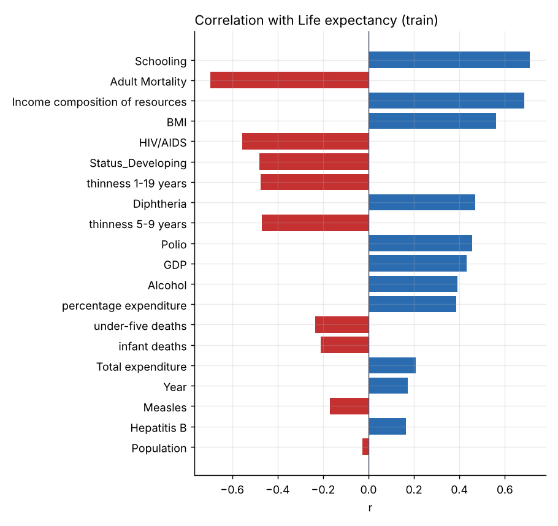
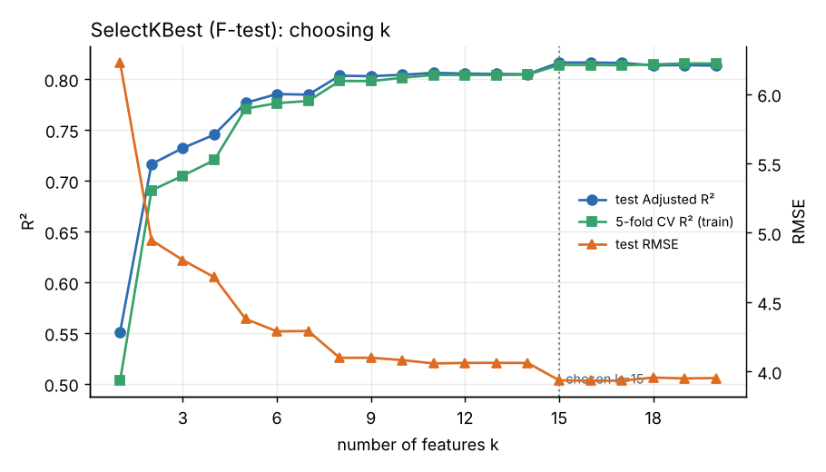
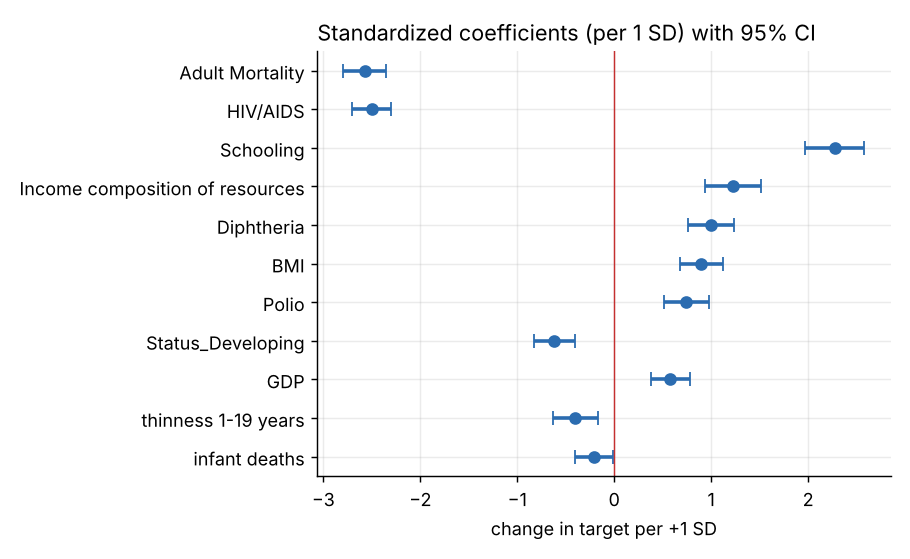
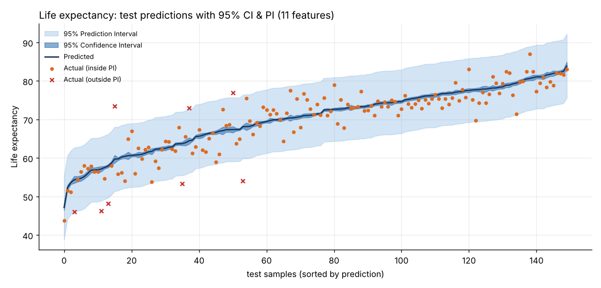
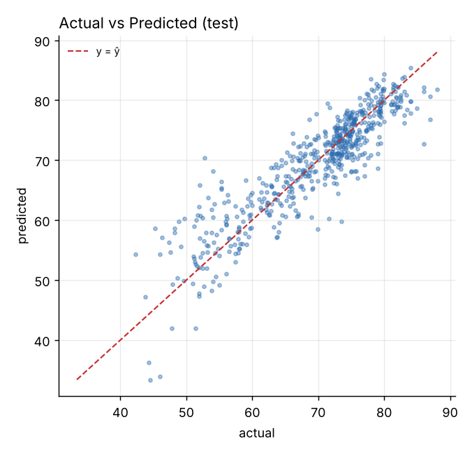
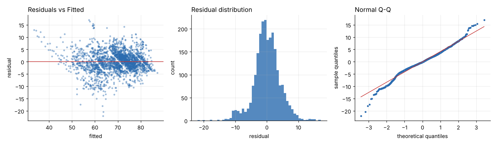
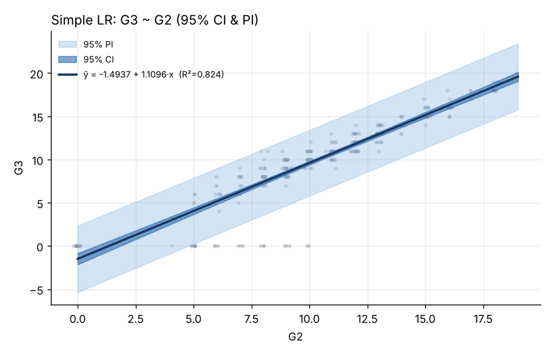

# HW2：多元線性回歸 (Multiple Linear Regression) × CRISP-DM

> 以 Kaggle 公開資料集完成「資料理解 → 特徵選擇 → OLS 建模 → 評估（含信賴區間 / 預測區間）→ 部署」的完整流程，並以 Streamlit 網頁互動呈現。

| 項目 | 連結 / 說明 |
|---|---|
| 🌐 線上網頁 (Web) | `https://<你的app名稱>.streamlit.app`　← 部署後填入 |
| 💻 GitHub | `https://github.com/<你的帳號>/HW2_MLR`　← 上傳後填入 |
| 📊 主要資料集 (Problem 1) | [WHO Life Expectancy — Kaggle](https://www.kaggle.com/datasets/kumarajarshi/life-expectancy-who)（2,938 筆，21 個特徵） |
| 📊 第二資料集 (Problem 2) | [Student Alcohol Consumption（student-mat.csv）— Kaggle](https://www.kaggle.com/datasets/uciml/student-alcohol-consumption)（395 筆，32 個特徵） |
| 🤖 AI 輔助 | 本專案程式與報告由 **Claude** 輔助產生，標示方式見〈Claude 輔助內容〉；NotebookLM 摘要見〈NotebookLM 摘要〉 |

### ✅ 作業要求與加分對照

| 要求 | 完成位置 |
|---|---|
| Kaggle 資料集，特徵數 > 13 | Problem 1：21 個特徵；Problem 2：32 個特徵 |
| 線性回歸（簡單 / 多元） | 網頁側欄「③ 模型類型」可切換 Simple LR / Multiple LR |
| 特徵選擇 (Feature Selection) | 7 種方法 + VIF 共線性篩除 + k 曲線（§4） |
| 模型評估 (Model Evaluation) | MAE / MSE / RMSE / R² / Adj. R² / 5-fold CV / 殘差假設檢驗（§5） |
| 預測圖 + 信賴區間 / 預測區間 | `figures/*_prediction_interval.png`、網頁 Evaluation 分頁 |
| CRISP-DM 六步驟 | 本報告 §1–§6、網頁六個分頁 |
| **加分 +1：下拉視窗呈現兩種 problem** | 網頁側欄「① 選擇 Problem」 |
| **加分 +2：可任意輸入 Dataset** | 側欄選「自訂 Dataset」→ 輸入 CSV 網址（預設即 `50_Startups.csv`）或直接上傳 CSV，可自選 target |

---

## 為什麼不是 Flood Prediction？（資料探索的發現）

一開始評估 Kaggle 的 [Flood Prediction Dataset](https://www.kaggle.com/datasets/naiyakhalid/flood-prediction-dataset)（20 個特徵）。實際跑 OLS 後發現 **FloodProbability 恰好等於 0.005 × (20 個特徵總和)**：R² = 1.000、殘差約 1e-15，信賴區間與預測區間寬度都趨近 0。這代表 target 是由特徵「算出來」的，沒有任何隨機誤差，無法有意義地呈現預測區間，因此改用真實觀測資料 **WHO Life Expectancy** 作為主要題目。

---

## 1. Business Understanding 商業理解　【Claude 輔助內容】

**Problem 1（主要）— 國家平均壽命預測**
衛生政策單位想知道：在成人死亡率、疫苗接種率、HIV/AIDS、教育年數、GDP、醫療支出等 21 個因素中，**哪些最能解釋一個國家的平均壽命**，並估計某國在給定條件下的平均壽命與其不確定範圍，作為資源配置的參考。

- 預測目標：`Life expectancy`（歲，連續數值）
- 成功標準：測試集 R² ≥ 0.75、RMSE 越小越好；95% 預測區間的實際覆蓋率接近 95%
- 選擇線性回歸的理由：係數可直接解讀（例如「教育年數 +1 年 → 壽命 +0.70 歲」），並能計算 CI / PI

**Problem 2 — 學生數學期末成績預測**
學校希望預測學生期末數學成績 `G3`（0–20 分），以便及早輔導。

## 2. Data Understanding 資料理解　【Claude 輔助內容】

| | Problem 1：Life Expectancy | Problem 2：Student |
|---|---|---|
| 資料筆數 × 欄位 | 2,938 × 22 | 395 × 33 |
| 原始特徵數 | **21**（Country, Year, Status + 18 個數值） | **32**（15 數值 + 17 類別，含 G1、G2） |
| Target | Life expectancy：平均 69.2、標準差 9.5、範圍 36.3–89.0 | G3：平均 10.4、標準差 4.6、範圍 0–20 |
| 缺值 | 2,563 個（Population 652、Hepatitis B 553、GDP 448…） | 無 |



觀察重點：
- 與壽命**正相關**最強：Schooling、Income composition of resources、BMI；**負相關**最強：Adult Mortality、HIV/AIDS
- `infant deaths` 與 `under-five deaths`、`thinness 1-19` 與 `thinness 5-9` 幾乎重複 → 預期有**多重共線性**
- 同一國家有 2000–2015 共 16 年資料（193 國），列與列之間並非完全獨立
- Problem 2 中 G3 有 38 位學生為 0 分（缺考），會造成殘差左偏

## 3. Data Preparation 資料準備　【Claude 輔助內容】

1. 移除 target 缺值的 10 筆 → 2,928 筆
2. `Country` 有 193 個類別，One-Hot 後特徵爆炸且容易過擬合 → 捨棄；`Status` 做 One-Hot（drop_first → `Status_Developing`）
3. **先切分再補值**：80/20 切分（訓練 2,342 / 測試 586，`random_state=42`），以**訓練集**中位數補齊 2,513 個缺值，避免 data leakage
4. 編碼後候選特徵 **20 個**（Problem 2 編碼後 41 個）
5. 數值穩定性：`Population`（最大 1.29e9）與其他特徵尺度差距極大，未標準化時最小平方解會失準（全特徵模型 R² 從 0.82 掉到 0.57）。因此所有模型在內部先做標準化求解，再把係數轉回原始單位，結果與 OLS 公式一致

## 4. Modeling 建模：特徵選擇 + OLS　【Claude 輔助內容】

### 4.1 特徵選擇方法比較（Problem 1，k = 10，只用訓練集選特徵）

| method | k | RMSE | R² | Adj. R² | 5-fold CV R² |
|:--|--:|--:|--:|--:|--:|
| All features（不選擇） | 20 | 3.9515 | 0.8195 | 0.8131 | 0.8153 |
| Correlation \|r\| top-k | 10 | 4.0808 | 0.8075 | 0.8041 | 0.8013 |
| SelectKBest (F-test) | 10 | 4.0808 | 0.8075 | 0.8041 | 0.8013 |
| RFE | 10 | 3.9532 | 0.8193 | 0.8162 | 0.8088 |
| Lasso (LassoCV) | 10 | 3.9532 | 0.8193 | 0.8162 | 0.8088 |
| Sequential Forward Selection | 10 | 4.0712 | 0.8084 | 0.8051 | 0.8041 |
| Backward Elimination (p<0.05) | 15 | 3.9518 | 0.8195 | 0.8147 | 0.8158 |

只用 10 個特徵就能達到全部 20 個特徵 98% 以上的 R²。RFE 與 Lasso 都同時選進 `infant deaths` 和 `under-five deaths`（兩者高度共線、係數正負相抵），所以預測稍好但係數難以解讀。

### 4.2 決定 k：k 曲線



規則：**5-fold CV R² 達到最佳值 99.5% 的最小 k** → k = 15（k 再增加幾乎沒有進步）。

### 4.3 三段式特徵選擇流程（最終模型）

| 階段 | 特徵數 | RMSE | R² | Adj. R² | CV R² | 最大 VIF |
|:--|--:|--:|--:|--:|--:|--:|
| All features | 20 | 3.9515 | 0.8195 | 0.8131 | 0.8153 | 168.28 |
| ① SelectKBest k=15 | 15 | 3.9352 | 0.8210 | 0.8163 | 0.8138 | 159.49 |
| ② + VIF < 10 篩除（移除 under-five deaths） | 14 | 4.0624 | 0.8092 | 0.8045 | 0.8039 | 8.13 |
| ③ + Backward elimination p<0.05（移除 thinness 5-9、Alcohol、percentage expenditure） | **11** | **4.0567** | **0.8097** | **0.8061** | **0.8039** | **3.20** |

最終模型以 **11 個特徵**換得 R² 只少約 0.01，但所有係數都顯著、VIF 全部 < 3.2，可解釋性大幅提升。

### 4.4 最終 OLS 模型（訓練集 R² = 0.8077，Adj. R² = 0.8068，F = 889.6，p < 0.001）

```
Life expectancy = 55.06 − 0.0207·AdultMortality − 0.0019·infantDeaths + 0.0450·BMI
                + 0.0318·Polio + 0.0416·Diphtheria − 0.4828·HIV/AIDS + 0.000044·GDP
                − 0.0911·thinness(1-19) + 6.039·IncomeComposition + 0.699·Schooling
                − 1.633·Status_Developing
```



標準化係數（特徵增加 1 個標準差的效果）顯示影響最大的是 **Adult Mortality（−）、HIV/AIDS（−）、Schooling（+）**；開發中國家在其他條件相同下平均壽命低約 1.6 歲（95% CI：−2.19 ~ −1.08）。

## 5. Evaluation 評估　【Claude 輔助內容】

### 5.1 測試集指標（Problem 1，最終 11 特徵模型）

| MAE | MSE | RMSE | R² | Adj. R² | 5-fold CV R² |
|--:|--:|--:|--:|--:|--:|
| 3.005 歲 | 16.457 | 4.057 歲 | 0.8097 | 0.8061 | 0.8039 ± 0.0135 |

對照組：全特徵 Ridge R² = 0.8194、全特徵 Lasso R² = 0.8191；只用 Schooling 的**簡單線性回歸** R² = 0.552、RMSE = 6.23 → 多元回歸明顯較好。

### 5.2 預測圖（95% 信賴區間 + 95% 預測區間）



- **深藍帶 = 95% 信賴區間 (CI)**：「平均」壽命的不確定範圍，平均寬度 **1.06 歲**
- **淺藍帶 = 95% 預測區間 (PI)**：「單一國家某一年」的壽命範圍，平均寬度 **16.6 歲**
- 測試集 586 筆中有 **94.0%** 落在 95% PI 內，與理論值 95% 非常接近
- PI 遠寬於 CI，因為 PI = ŷ ± t·s·√(1 + h)，多了個體本身的隨機誤差

公式（h = x₀ᵀ(XᵀX)⁻¹x₀）：

- CI：ŷ₀ ± t(α/2, n−p−1) · s · √h
- PI：ŷ₀ ± t(α/2, n−p−1) · s · √(1 + h)



### 5.3 線性回歸假設檢驗



| 假設 | 檢定 | 結果 | 判讀 |
|---|---|---|---|
| 獨立性 | Durbin-Watson | 2.00 | 無自相關 ✅ |
| 常態性 | Jarque-Bera | p < 0.001（峰度 4.7） | 尾部略厚；n = 2,342 大樣本下，係數推論仍可依中央極限定理成立 ⚠️ |
| 同質變異 | Breusch-Pagan | p < 0.001 | 有異質變異（低壽命國家殘差較大）⚠️ |
| 共線性 | VIF | 最大 3.20 | 可接受 ✅ |

### 5.4 Problem 2（學生成績）結果摘要

| 模型 | 特徵數 | RMSE | R² | Adj. R² | 95% PI 覆蓋率 |
|:--|--:|--:|--:|--:|--:|
| 全部特徵 OLS | 41 | 2.378 | 0.724 | 0.418 | – |
| **SelectKBest k=2（G1, G2）** | 2 | **2.052** | **0.795** | **0.789** | **94.9%** |
| 簡單線性回歸（G2） | 1 | 2.053 | 0.794 | 0.792 | – |
| 移除 G1、G2 後（只用背景變數，k=5） | 5 | 4.358 | 0.074 | 0.010 | – |

模型：`G3 = −2.04 + 0.163·G1 + 0.993·G2`。全部 41 個特徵反而 Adj. R² 只有 0.418（嚴重過擬合），說明特徵選擇的重要性。若想在**段考之前**就做預警（不使用 G1、G2），線性模型幾乎沒有預測力（R² < 0.1），需要更多資料或非線性模型。



## 6. Deployment 部署　【Claude 輔助內容】

網頁以 **Streamlit** 製作，六個分頁對應 CRISP-DM 六步驟：

- 側欄 **① 選擇 Problem**（下拉選單：Problem 1 / Problem 2 / 自訂 Dataset）
- 自訂 Dataset：輸入任意 CSV 網址（自動判斷 `,` `;` `Tab` 分隔）或上傳檔案，自選 target；類別欄自動 One-Hot、缺值自動補齊
- 可調整：使用的特徵、Simple / Multiple LR、特徵選擇方法、k、VIF 篩除、信賴水準 80–99%、測試集比例
- Deployment 分頁：輸入新資料 → 即時顯示預測值、信賴區間、預測區間與模型方程式；可下載預測結果與係數表

### 本機執行

```bash
pip install -r requirements.txt
streamlit run app.py          # 網頁
python analysis.py            # 重新產生 figures/ 與 results/
```

### 部署到 Streamlit Community Cloud

1. 把整個資料夾 push 到 GitHub（公開 repo）
2. 到 <https://share.streamlit.io> 用 GitHub 登入 → **Create app**
3. 選擇 repo、branch `main`、Main file `app.py` → **Deploy**
4. 取得網址後，填回本 README 最上方表格

### 專案結構

```
HW2_MLR/
├── app.py               # Streamlit 網頁（CRISP-DM 六分頁、兩題下拉、自訂資料集）
├── mlr_core.py          # 核心：資料準備、特徵選擇、OLS（含 CI/PI）、評估、繪圖
├── analysis.py          # 離線產生報告圖表與數據
├── requirements.txt
├── data/
│   ├── life_expectancy.csv   # Kaggle: kumarajarshi/life-expectancy-who
│   └── student-mat.csv       # Kaggle: uciml/student-alcohol-consumption
├── figures/             # 報告用圖（相關係數、k 曲線、預測區間、殘差、係數）
└── results/             # 各階段數據（CSV / JSON）
```

---

## 結論與限制

1. WHO 平均壽命可由 11 個因素以線性回歸解釋約 81% 的變異，測試誤差約 ±4 歲；成人死亡率、HIV/AIDS 與教育年數是最關鍵的因素。
2. 特徵選擇在兩題都證明有效：Problem 1 從 20 → 11 個特徵幾乎不損失準確度；Problem 2 從 41 → 2 個特徵反而提升測試表現。
3. 95% 預測區間的實際覆蓋率（94.0%、94.9%）接近理論值，表示區間估計可信。
4. **限制**：同一國家多年資料以隨機方式切分，測試集可能「看過」同國其他年份，表現可能略被高估（改進：依國家做 GroupKFold）；殘差有異質變異與厚尾，可改用穩健標準誤或對 target 做轉換。

---

## Claude 輔助內容

> 本作業使用 **Claude（Anthropic）** 作為 AI 助理（取代作業說明中的 ChatGPT），對話紀錄另以 PDF 匯出繳交。以下標示各部分的 AI 協助程度。

| 部分 | Claude 協助內容 | 本人工作 |
|---|---|---|
| 資料集選擇 | 比對候選資料集、發現 Flood 資料集 target 為特徵線性和而改選 WHO 資料 | 確認題目與資料來源 |
| `mlr_core.py` / `analysis.py` | 撰寫資料準備、7 種特徵選擇、OLS 推論、CI/PI、VIF、殘差檢定與繪圖程式 | 執行、檢查結果 |
| `app.py` | 撰寫 Streamlit 網頁（兩題下拉、自訂 Dataset、六個 CRISP-DM 分頁） | 部署到 Streamlit Cloud |
| 報告 §1–§6 | 依程式輸出撰寫分析文字與表格（標有【Claude 輔助內容】的段落） | 校閱、修改 |
| NotebookLM 摘要 | 未參與（由本人以 NotebookLM 完成） | ✍️ |

---

## NotebookLM 摘要

> ✍️ **待補（需由本人使用 NotebookLM 完成，請勿由 Claude 代寫）**
>
> 建議放入 NotebookLM 的來源：
> 1. Kaggle 資料集頁面：https://www.kaggle.com/datasets/kumarajarshi/life-expectancy-who
> 2. EnjoyAlgorithms：Life Expectancy Prediction using Linear Regression — https://enjoyalgorithms.com/blog/life-expectancy-prediction-using-linear-regression
> 3. USCLAP：Predicting Life Expectancy Using Global Data in 2015 — https://causeweb.org/usproc/sites/default/files/usclap/2024-1/usclap%203240%20-%20predicting%20life%20expectancy%20using%20global%20data%20in%202015.pdf
> 4. Stanford Intersect：Change in Life Expectancy Across Countries — https://ojs.stanford.edu/ojs/index.php/intersect/article/view/3445
> 5. i-JOE：Life Expectancy Prediction through Analysis of Immunization and HDI Factors — https://online-journals.org/index.php/i-joe/article/view/33315
>
> 建議提問：「請比較這些來源用 WHO Life Expectancy 資料做回歸時，資料前處理、特徵選擇、模型與評估指標的做法，並與多元線性回歸的結果比較，用繁體中文寫 150 字摘要。」
>
> 將 NotebookLM 的回答貼在這裡（≥ 100 字）。
